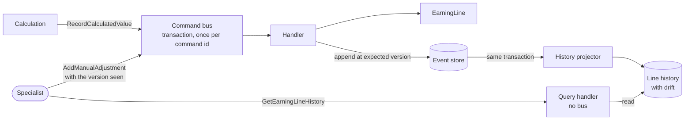

# Earning Line

A payroll earning line with a transparent, append-only history of manual adjustments.

The payroll calculation produces the value of a line and may recalculate it when source data changes. A payroll specialist can correct the line with signed manual adjustments, each with a mandatory comment. Adjustments are never edited or removed; a mistake is fixed by a compensating adjustment. The first adjustment freezes the line, so later recalculations no longer change it. The current value and the full history are available at any time.

**Release 1.1.0** stores lines as their events and changes them only through commands: the payroll calculation and specialists send commands to a command bus, and a specialist reads the line from a separate history model that also shows drift. Everything is plain PHP; storage sits behind ports with in-memory adapters, so a database is one more adapter. The domain model of release 1.0.0 did not change. See the [plan](docs/project/plan.md).

## Quick start

Only Docker and `make` are needed.

```bash
make install   # build the image and install dependencies
make demo      # play the reference scenario and print the history
make qa        # coding style, static analysis with architecture rules, all tests
```

`make demo` sends the reference scenario as commands, then prints every step, the history a specialist reads and the full log:

```text
History
Entry                  Value      Comment
---------------------  ---------  ----------------------------------------------
System value (frozen)  $1,050.00
Adjustment 1           -$45.55    Dental plan waived: benefit amount removed
Adjustment 2           +$100.10   Approved overtime missing from the source data
Adjustment 3           -$0.10     Rounding
Adjustment 4           -$0.20     Rounding, second pass
Adjustment 5           +$0.20     Reverts adjustment #4, entered by mistake
Current value          $1,104.45
Drift                  +$50.00    latest calculation $1,100.00, not applied
```

The full log below it also keeps the first value ($1,000.00) and the recalculation that was ignored because the line was frozen. At the end the demo sends step 5 again (nothing changes), lets a second specialist adjust a version they no longer see (refused) and drops the history and rebuilds it from the events (the same history).

## How it works

`EarningLine` is an aggregate that **records events and changes its state only by applying them** ([ADR 0005](docs/common/adr/0005-state-changes-through-events.md)). The history is not a log written next to the state: it is the state's source, and replaying it rebuilds the same line.

| Fact | When | Effect on the value |
|---|---|---|
| `SystemValueCalculated` | the calculation creates the line | value = system value |
| `SystemValueRecalculated` | a different value for an open line | value replaced |
| `ManualAdjustmentAdded` | a specialist adjusts the line | value += amount; the line is frozen for good |
| `SystemRecalculationIgnored` | a different value for a frozen line | none; kept for the audit |

Current value = frozen (or latest) system value + sum of adjustments. Money is held in integer cents, so −0.10 + −0.20 is exactly −0.30 ([ADR 0003](docs/payroll/adr/0003-money-in-minor-units.md)).

### Writing and reading



- **Commands** carry an id chosen by the sender. The bus carries a command out at most once per id, in a transaction: a repeated command does nothing, and a failed one leaves no trace ([ADR 0009](docs/common/adr/0009-one-command-bus.md)).
- **Optimistic concurrency:** every save states the version it was based on. A specialist sends the version of the line they looked at, so two specialists cannot both correct the same value they saw ([ADR 0008](docs/common/adr/0008-optimistic-concurrency.md)).
- **History for reading** is projected from the events in the same transaction, so it is never behind them, and it can be rebuilt from all events at any time ([ADR 0010](docs/common/adr/0010-synchronous-projections.md)). It shows **drift**: how far the latest calculation is from the frozen value, without applying it ([ADR 0011](docs/payroll/adr/0011-drift-in-the-history.md)). It is read through the `GetEarningLineHistory` query, called directly: reading needs no transaction, so it goes through no bus.

## A five-minute tour

| Rule | Code | Test |
|---|---|---|
| Adjustment: signed, non-zero, mandatory comment | [`EarningLine::addManualAdjustment`](src/Payroll/Domain/EarningLine.php), [`AdjustmentComment`](src/Payroll/Domain/AdjustmentComment.php) | [`EarningLineTest`](tests/Payroll/Unit/Domain/EarningLineTest.php), [`AdjustmentCommentTest`](tests/Payroll/Unit/Domain/AdjustmentCommentTest.php) |
| Adjustments are append-only | no edit or delete method exists | `EarningLineTest::testOffersNoWayToEditOrRemoveAnAdjustment` |
| The first adjustment freezes the line | [`EarningLine::recordSystemValue`](src/Payroll/Domain/EarningLine.php) ([ADR 0006](docs/payroll/adr/0006-freeze-and-ignored-recalculations.md)) | `EarningLineTest::testARecalculationOfAFrozenLineIsRecordedButChangesNothing` |
| Current value and full history | `EarningLine::currentValue`, `adjustments`, the recorded events | [`ReferenceScenarioTest`](tests/Payroll/Scenario/ReferenceScenarioTest.php) |
| Invariants hold beyond the examples | | [`EarningLinePropertiesTest`](tests/Payroll/Unit/Domain/EarningLinePropertiesTest.php) |
| Exact money | [`Money`](src/Payroll/Domain/Money.php) | [`MoneyTest`](tests/Payroll/Unit/Domain/MoneyTest.php) |
| A repeated command is carried out once | [`CommandBus`](src/Common/Application/Command/CommandBus.php) | [`CommandBusTest`](tests/Common/Unit/Application/CommandBusTest.php) |
| Nobody adjusts a version they have not seen | [`AddManualAdjustmentHandler`](src/Payroll/Application/Command/AddManualAdjustmentHandler.php), [`EarningLines`](src/Payroll/Application/Command/EarningLines.php) | [`AddManualAdjustmentTest`](tests/Payroll/Application/AddManualAdjustmentTest.php) |
| The history agrees with the line and shows drift | [`EarningLineHistoryProjector`](src/Payroll/Application/History/EarningLineHistoryProjector.php) | [`EarningLineHistoryTest`](tests/Payroll/Application/EarningLineHistoryTest.php), [`EarningLineHistoryPropertiesTest`](tests/Payroll/Application/EarningLineHistoryPropertiesTest.php) |
| Every store behaves the same | ports in `src/*/Application` and its folders, adapters in `app/Modules/*/InMemory` | contract tests in `tests/*/Contract` |

```
src/Common/Domain         aggregate root shared by modules
src/Common/Application    event store port, command bus, projectors
src/Payroll/Domain        the earning line: rules, events, value objects
src/Payroll/Application   commands and handlers, queries, repository, line history
app/Modules/*/InMemory    in-memory adapters and wiring
app/Modules/Payroll/Cli   the command-line demo
tests/<Module>            tests grouped like the code
docs/                     architecture, ADRs and reviews, grouped by module
```

## Assumptions

The business rules leave a few things open. The code makes these assumptions, each listed with what would change in the [open questions](docs/payroll/domain.md#open-questions):

- A line is known **only by its id**. The employee, the period and the kind of earning belong to the pay run that contains the line, which is not modelled here.
- The calculation sends the **whole value** of the line; a specialist sends a **signed change**. A specialist cannot set the value directly, so every correction stays visible.
- The system value frozen by the first adjustment is the **latest** one, not the first.
- Freezing is **permanent**, even if the adjustments add up to zero.
- A recalculation of a frozen line is **recorded but not applied**; a value equal to the last one sent is not recorded at all.
- An adjustment of zero is rejected; the value of a line may become negative.
- One currency per line, two decimal places; comments up to 500 characters; times stored in UTC.
- The sender of a command chooses its id and keeps it when it repeats the command; ids are remembered for good.
- A specialist's adjustment is refused if the line changed since they looked at it, even by an ignored recalculation.
- Drift is shown, never applied; what a specialist does about it is an open question.

Edge cases, each with its test, are listed in the [domain document](docs/payroll/domain.md#edge-cases).

## How this was built

Every step of the [plan](docs/project/plan.md) is one commit with its code, tests, ADR, changelog entry and documentation. AI agents wrote most of the code under the rules of the [AI workflow](docs/project/ai-workflow.md); a separate AI reviewer checked every step, and its findings were folded into the step. The reviews are listed in the [review index](docs/reviews.md), and the [review index](docs/reviews.md#what-the-ai-got-wrong-and-how-it-was-caught) also lists what the AI got wrong and how it was caught.

## Documentation

- [Domain: rules, lifecycle, reference scenario, edge cases, open questions](docs/payroll/domain.md)
- [Architecture](docs/architecture.md)
- [Common architecture: event store, command bus, projectors](docs/common/architecture.md)
- [Payroll architecture](docs/payroll/architecture.md)
- [All documents](docs/README.md)
- [Changelog](CHANGELOG.md)
