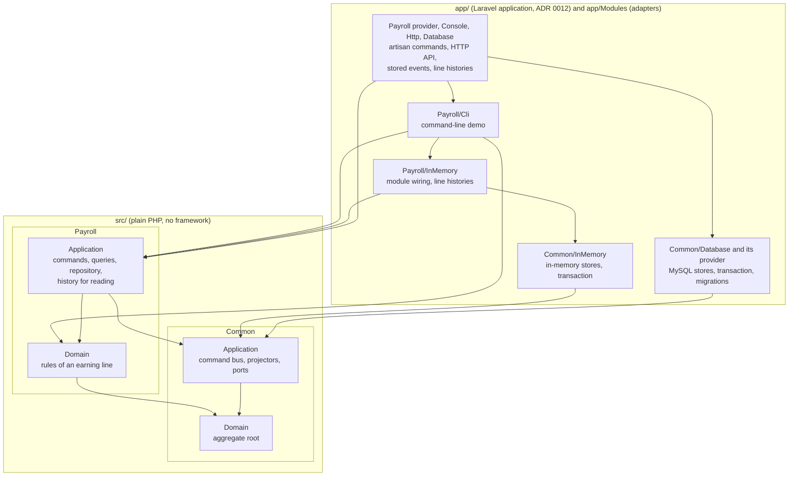

# Architecture

How the repository is built: modules, layers and the checks that keep them apart. Every step of the [plan](project/plan.md) updates the architecture documents together with the code.

## 1. Modules and layers

Arrows point in the direction of dependencies. The rules of [ADR 0001](project/adr/0001-layers-and-modules.md) apply:

| Rule | Why |
|---|---|
| Domain depends on nothing outside domain layers | business rules are testable on their own |
| Application depends only on domain and application layers; it reaches storage through ports | use cases do not change when storage changes |
| `Common` never depends on `Payroll` | shared building blocks can serve any module |
| `src/` never depends on a framework or library | storage and framework are replaceable tools |
| Adapters in `app/` depend on the core, never the other way round | the core does not know how it is used |
| In-memory adapters and the command-line demo do not depend on Laravel ([ADR 0012](project/adr/0012-laravel-inside-app.md)) | the core keeps running without a framework |

Each module describes its own architecture next to its other documents: [Common](common/architecture.md) (building blocks, saving a change, carrying out a command, reading, guarantees) and [Payroll](payroll/architecture.md) (context, domain model, storage, commands, history for reading, ways in, guarantees).

### Folders inside a layer

Every layer of every module is laid out the same way, so a class is found by what it does:

| Folder | What it holds |
|---|---|
| root of the layer | what the other parts of the layer are built around: the aggregate and value objects in a domain layer; the ports shared by the whole layer in an application layer, if there are any |
| `Event/` | the events of a domain layer |
| `Exception/` | every exception of the layer |
| any other folder | one part of the layer, named after what its classes do together |

A folder is named after what its classes do, not after the pattern they follow, so a class that serves two patterns still has one obvious place. Where the exceptions of `src/` live is checked by phpat; the rest is checked in review.

## 2. Quality checks

| Check | Tool | Command |
|---|---|---|
| Coding style (PER-CS 2.0, strict types) | PHP CS Fixer | `make cs` |
| Types at the maximum level, strict rules | PHPStan | `make stan` |
| Dependency rules of ADR 0001 and ADR 0012 | phpat, inside PHPStan | `make stan` |
| Every exception in `src/` lives in the `Exception/` folder of its layer | phpat, inside PHPStan | `make stan` |
| Tests that need no database, in random order | PHPUnit | `make test` |
| Tests of the Laravel adapters against MySQL | PHPUnit, suite `integration` | `make test-integration` |

`make qa` runs all of them except the tests against MySQL in the Docker image; `make test-integration` starts MySQL in Docker Compose and runs those. CI runs the same checks on every push and pull request with the same PHP version, the tests against MySQL in a separate job, and also builds the image. The testing approach is described in [ADR 0002](project/adr/0002-testing-strategy.md).
