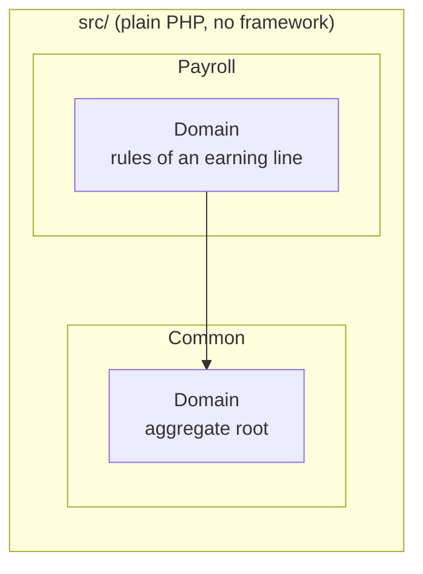

# Architecture

How the repository is built: modules, layers and the checks that keep them apart. Every step of the [plan](project/plan.md) updates the architecture documents together with the code.

## 1. Modules and layers

Arrows point in the direction of dependencies. The rules of [ADR 0001](project/adr/0001-layers-and-modules.md) apply:

| Rule | Why |
|---|---|
| Domain depends on nothing outside domain layers | business rules are testable on their own |
| `Common` never depends on `Payroll` | shared building blocks can serve any module |
| `src/` never depends on a framework | storage and framework are replaceable tools |

Each module describes its own architecture next to its other documents: [Payroll](payroll/architecture.md) (context, domain model, guarantees).

## 2. Quality checks

| Check | Tool | Command |
|---|---|---|
| Coding style (PER-CS 2.0, strict types) | PHP CS Fixer | `make cs` |
| Types at the maximum level, strict rules | PHPStan | `make stan` |
| Dependency rules of ADR 0001 | phpat, inside PHPStan | `make stan` |
| Tests, in random order | PHPUnit | `make test` |

`make qa` runs all of them in the Docker image. CI runs the same checks on every push and pull request with the same PHP version, and also builds the image. The testing approach is described in [ADR 0002](project/adr/0002-testing-strategy.md).
