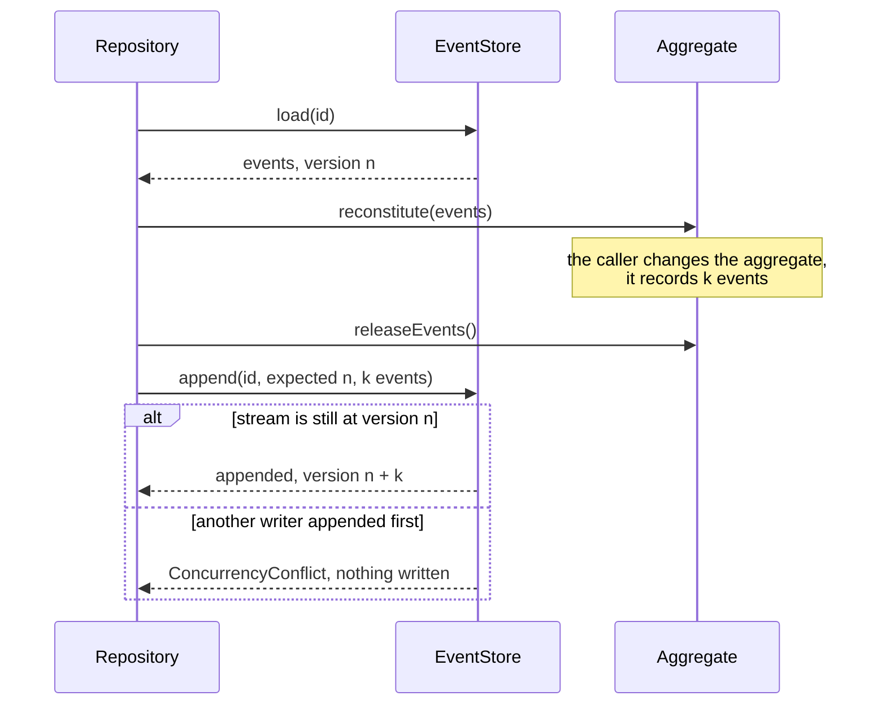
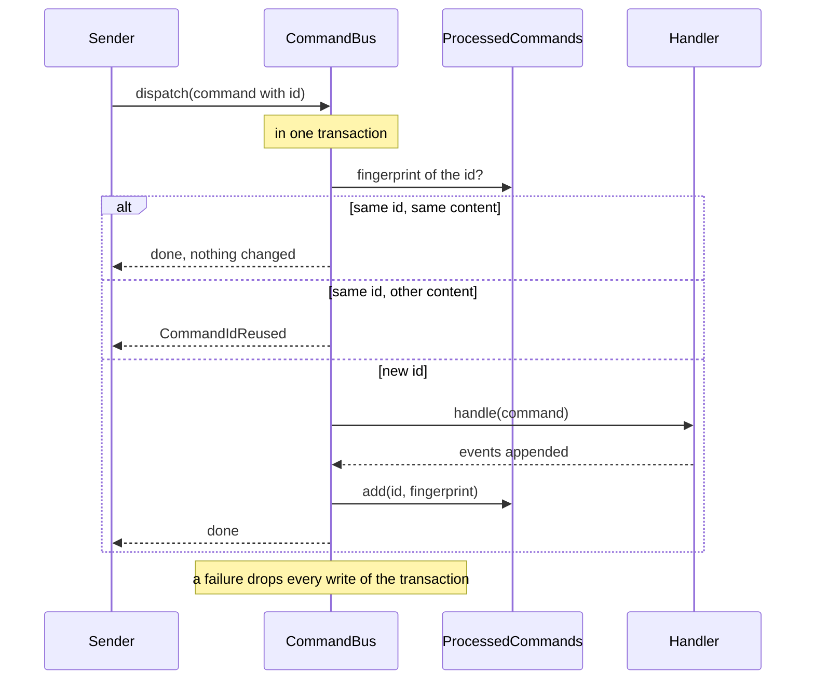

# Common architecture

Building blocks that any module can use. They know nothing about business modules. Modules, layers and quality checks of the whole repository are in the [architecture overview](../architecture.md).

## 1. Building blocks

| Layer | Building block | What it does |
|---|---|---|
| Domain | `AggregateRoot`, `DomainEvent` | an aggregate decides, records an event and changes its state only by applying events; the same code replays its history ([ADR 0005](adr/0005-state-changes-through-events.md)) |
| Application | `EventStore` (port), `ConcurrencyConflict` | keeps the events of each aggregate in a stream; refuses a change based on an outdated version ([ADR 0007](adr/0007-own-event-sourcing-core.md), [ADR 0008](adr/0008-optimistic-concurrency.md)) |
| Application | `Command`, `SafeToRetryOnConflict` | a request with an id chosen by its sender; the marker says the bus may run it again after a conflict |
| Application | `CommandBus` | carries out commands from senders: runs the handler of a command in a transaction, at most once per command id ([ADR 0009](adr/0009-one-command-bus.md)) |
| Application | `Transaction`, `ProcessedCommands`, `Clock` (ports) | keeps writes together or drops them all; remembers carried out commands by id and fingerprint; the current time |
| Adapter | `App\Modules\Common\InMemory\InMemoryEventStore`, `InMemoryProcessedCommands` | stores in the memory of the running process |
| Adapter | `App\Modules\Common\InMemory\InMemoryTransaction` | takes a snapshot of the in-memory stores and puts it back when the work fails |

## 2. Saving a change

## 3. Carrying out a command

On a `ConcurrencyConflict` the bus runs the command once more only if it is `SafeToRetryOnConflict`; otherwise the conflict goes back to the sender. If another run of the same command recorded its id first, the second run is dropped and run again, which then finds the id and does nothing.

## 4. Guarantees

| What can go wrong | Guarantee | Test |
|---|---|---|
| A change decided on an outdated state is written over a newer one | append at an expected version; a conflict writes nothing | `EventStoreContract::testRefusesAChangeBasedOnAnOutdatedVersionAndWritesNothing` |
| An aggregate is created twice | creating is an append at version 0 | `EventStoreContract::testRefusesToStartAStreamThatAlreadyExists` |
| Half of a batch is written | a store appends all events or none | `EventStoreContract::testRefusesAnEventOfAnotherAggregateAndWritesNoneOfTheBatch` |
| Events of one aggregate end up in another's stream | a store checks the aggregate id of every event | `EventStoreContract::testRefusesAnEventOfAnotherAggregateAndWritesNoneOfTheBatch` |
| A new store behaves differently from the tested one | every store runs the same contract tests | `EventStoreContract`, `ProcessedCommandsContract` |
| A sender repeats a command and it is carried out twice | the bus skips an id it has carried out | `CommandBusTest::testARepeatedCommandDoesNothing` |
| A sender reuses an id for another request and it is silently skipped | the content is compared by fingerprint; other content is refused | `CommandBusTest::testRefusesAKnownIdWithOtherContentAndDoesNothing` |
| Two runs of the same command check the id at the same moment and both are carried out | an id is stored only once; the losing run is dropped | `CommandBusTest::testACommandThatAnotherRunCarriedOutFirstIsSkipped` |
| A command fails halfway and leaves part of its writes | the handler runs in a transaction; the command is not marked as carried out | `CommandBusTest::testAFailedCommandLeavesNoTraceAndCanBeSentAgain` |
| A decision made on what a person saw is applied to a state they did not see | only commands marked safe are retried after a conflict | `CommandBusTest::testAConflictIsReturnedToASenderWhoDecidedOnWhatTheySaw` |
