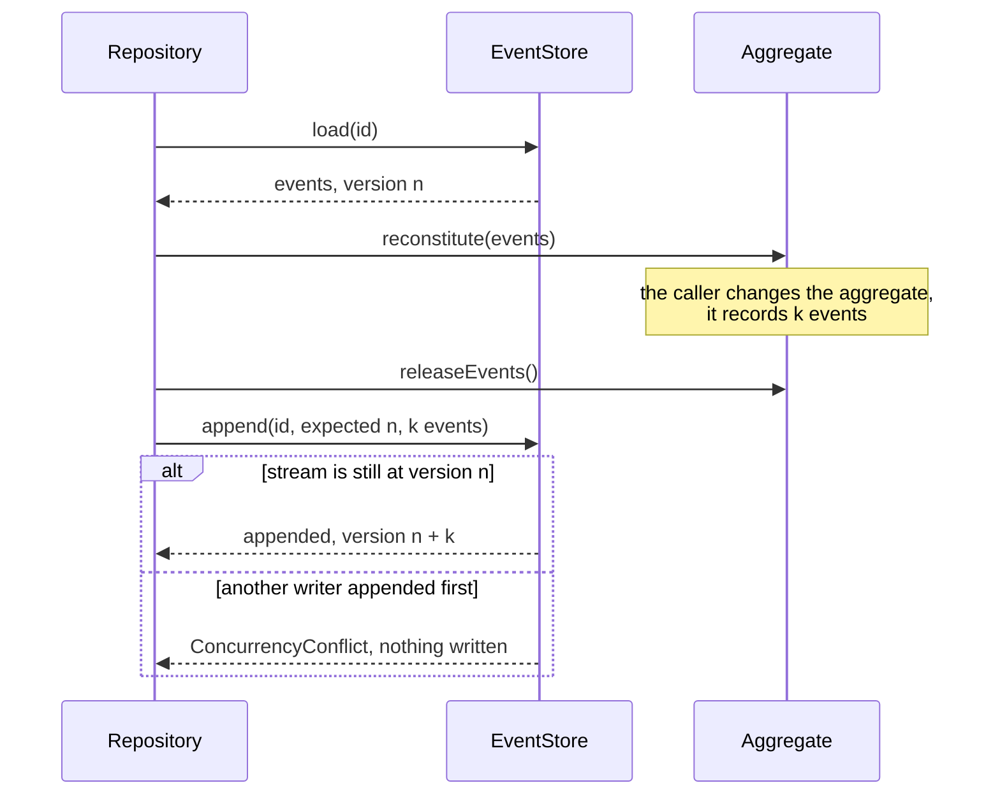

# Common architecture

Building blocks that any module can use. They know nothing about business modules. Modules, layers and quality checks of the whole repository are in the [architecture overview](../architecture.md).

## 1. Building blocks

| Layer | Building block | What it does |
|---|---|---|
| Domain | `AggregateRoot`, `DomainEvent` | an aggregate decides, records an event and changes its state only by applying events; the same code replays its history ([ADR 0005](adr/0005-state-changes-through-events.md)) |
| Application | `EventStore` (port), `ConcurrencyConflict` | keeps the events of each aggregate in a stream; refuses a change based on an outdated version ([ADR 0007](adr/0007-own-event-sourcing-core.md), [ADR 0008](adr/0008-optimistic-concurrency.md)) |
| Adapter | `App\Modules\Common\InMemory\InMemoryEventStore` | event store in the memory of the running process |

## 2. Saving a change

## 3. Guarantees

| What can go wrong | Guarantee | Test |
|---|---|---|
| A change decided on an outdated state is written over a newer one | append at an expected version; a conflict writes nothing | `EventStoreContract::testRefusesAChangeBasedOnAnOutdatedVersionAndWritesNothing` |
| An aggregate is created twice | creating is an append at version 0 | `EventStoreContract::testRefusesToStartAStreamThatAlreadyExists` |
| Half of a batch is written | a store appends all events or none | `EventStoreContract::testRefusesAnEventOfAnotherAggregateAndWritesNoneOfTheBatch` |
| Events of one aggregate end up in another's stream | a store checks the aggregate id of every event | `EventStoreContract::testRefusesAnEventOfAnotherAggregateAndWritesNoneOfTheBatch` |
| A new store behaves differently from the tested one | every store runs the same contract tests | `EventStoreContract` |
