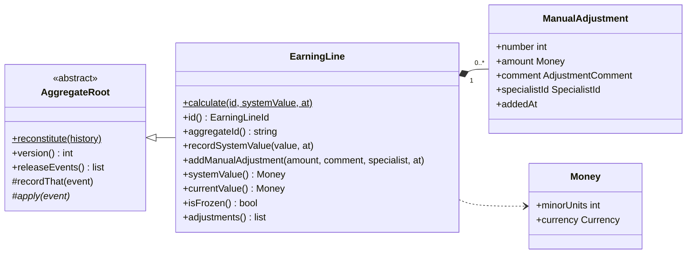
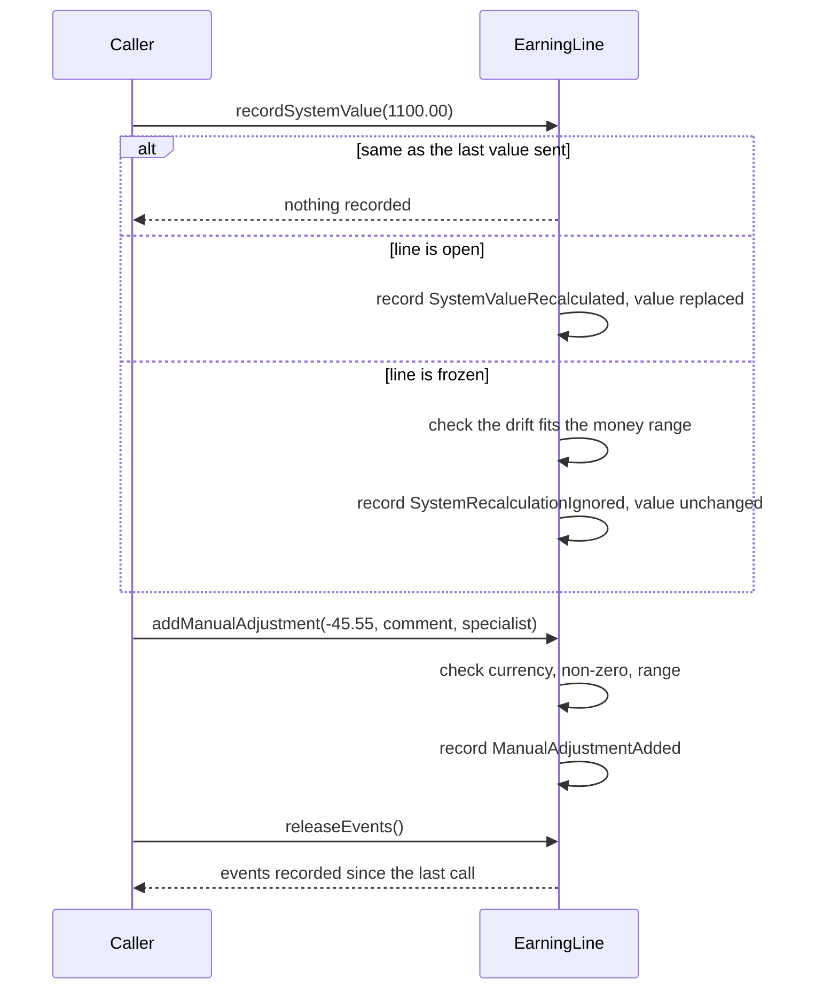

# Payroll architecture

How the Payroll module is built, from the outside in: who uses an earning line, its domain model and what it guarantees. Modules, layers and quality checks of the whole repository are in the [architecture overview](../architecture.md).

## 1. Context

- **Payroll calculation** computes the value of a line from source data and sends it again whenever the source data changes. It is outside this project.
- **Payroll specialist** reviews lines and corrects them with manual adjustments.
- **Earning line** keeps the value, applies the rules and keeps the history.

## 2. Domain model

`EarningLine` decides and records an event; `apply()` changes the state. The same `apply()` replays the history, so a rebuilt line equals the original ([ADR 0005](../common/adr/0005-state-changes-through-events.md)).

## 3. Guarantees

What can go wrong, what prevents it and which test proves it. Rows are added in the step that introduces the guarantee.

| What can go wrong | Guarantee | Test |
|---|---|---|
| A sum of adjustments is off by a fraction of a cent | integer minor units, parsed from strings ([ADR 0003](adr/0003-money-in-minor-units.md)) | `MoneyTest::testAddsWithoutFloatingPointErrors` |
| An inexact or overflowing amount enters the history | `Money` rejects fractions of a cent and amounts out of range | `MoneyTest` |
| An adjustment is edited or removed | `EarningLine` has no method for it | `EarningLineTest::testOffersNoWayToEditOrRemoveAnAdjustment` |
| A recalculation changes a frozen line | the aggregate records it as ignored ([ADR 0006](adr/0006-freeze-and-ignored-recalculations.md)) | `EarningLineTest::testARecalculationOfAFrozenLineIsRecordedButChangesNothing` |
| A rejected action leaves a partial trace | rules are checked before an event is recorded | `EarningLineTest::testRejectsAZeroAdjustmentWithoutATrace` |
| A corrupted history yields a line with different money | replay checks the rules and throws | `EarningLineReplayTest::testRefusesACorruptedHistory` |
| A rebuilt line behaves differently from the original | state changes only in `apply()`, which also replays ([ADR 0005](../common/adr/0005-state-changes-through-events.md)) | `EarningLineReplayTest::testARebuiltLineContinuesWhereTheOriginalStopped` |
| An adjustment is saved without a real explanation | `AdjustmentComment` rejects blank and whitespace-only comments | `AdjustmentCommentTest` |

## 4. Rules for the code

Rules of this module on top of the [AI workflow](../project/ai-workflow.md#rules-for-the-code):

- **No floats for money.** Amounts are parsed from strings into integer minor units.
- **Fail loudly on a broken history.** Replaying a line's events that contradict the rules is an error, never a silent repair.
