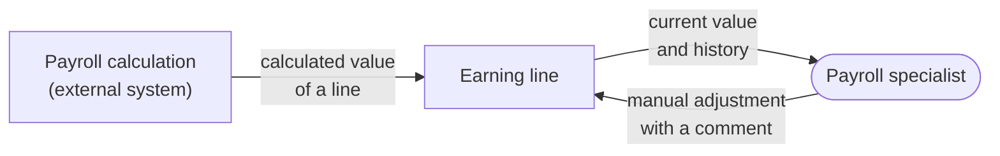
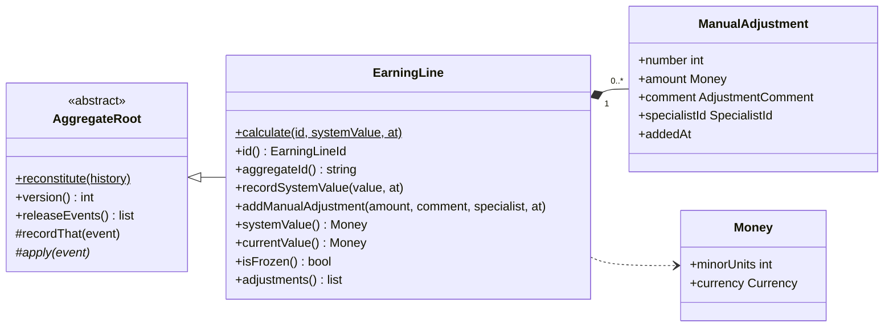
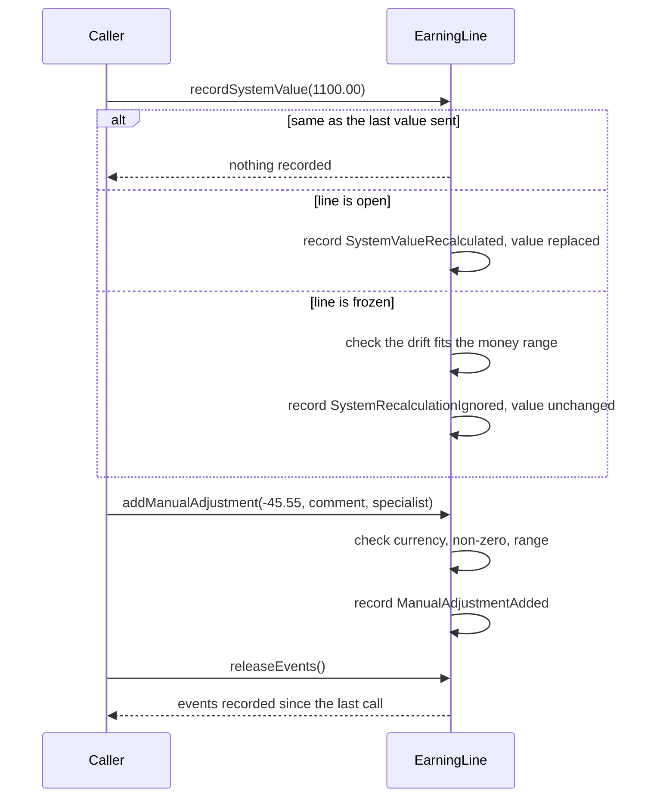

# Payroll architecture

How the Payroll module is built, from the outside in: who uses an earning line, its domain model, how lines are stored and changed, and what it guarantees. Modules, layers and quality checks of the whole repository are in the [architecture overview](../architecture.md).

## 1. Context

- **Payroll calculation** computes the value of a line from source data and sends it again whenever the source data changes. It is outside this project.
- **Payroll specialist** reviews lines and corrects them with manual adjustments.
- **Earning line** keeps the value, applies the rules and keeps the history.

## 2. Domain model

`EarningLine` decides and records an event; `apply()` changes the state. The same `apply()` replays the history, so a rebuilt line equals the original ([ADR 0005](../common/adr/0005-state-changes-through-events.md)).

## 3. Storage

`Payroll\Application\Command\EarningLines` stores a line as its events in the [event store](../common/architecture.md) of the shared core. The stream id is the line id.

| Operation | Result |
|---|---|
| `get(id)` | the line rebuilt from its events; `EarningLineNotFound` if there are none |
| `find(id)` | the same, or `null` |
| `save(line)` | appends what the line recorded since it was loaded or created, at the version it was loaded with; `ConcurrencyConflict` if the line changed in the meantime ([ADR 0008](../common/adr/0008-optimistic-concurrency.md)); a line object whose save failed is not saved again, it has to be loaded anew |

A stored history that breaks the rules of the domain, such as a recalculation before the first calculation or an amount in another currency, cannot be input from a user. `get` and `find` report it as `CorruptedEarningLineEvents`.

## 4. Commands

Senders change lines with commands, carried out by the [command bus](../common/architecture.md#3-carrying-out-a-command). Commands carry values as the sender sent them: amounts as decimal strings and currencies as codes; each command turns them into money itself. The commands, their handlers and the repository they use are in `Application/Command/`.

| Command | Sender | Handler does | Refused when |
|---|---|---|---|
| `RecordCalculatedValue` | payroll calculation | creates the line with the first value; later values go to `recordSystemValue` | unknown currency, inexact amount, another currency than the line's |
| `AddManualAdjustment` | specialist | adds the adjustment with the author and the time of the clock | the line does not exist (`EarningLineNotFound`), the line is not at the version the specialist saw (`ConcurrencyConflict`), any rule of the domain |

- `RecordCalculatedValue` is safe to retry: the calculation sends a whole value that does not depend on what it saw of the line. If two first values arrive at once, one creates the line and the other is run again as a recalculation.
- `AddManualAdjustment` carries the version of the line the specialist looked at. A change in between, even a recalculation that the line ignores, refuses the adjustment, so a specialist never corrects a line they have not seen (open question Q16).
- A rejected command records nothing and is not marked as carried out, so the sender can correct it and send it again under the same id.

## 5. Guarantees

What can go wrong, what prevents it and which test proves it. Rows are added in the step that introduces the guarantee.

| What can go wrong | Guarantee | Test |
|---|---|---|
| A sum of adjustments is off by a fraction of a cent | integer minor units, parsed from strings ([ADR 0003](adr/0003-money-in-minor-units.md)) | `MoneyTest::testAddsWithoutFloatingPointErrors` |
| An inexact or overflowing amount enters the history | `Money` rejects fractions of a cent and amounts out of range | `MoneyTest` |
| An adjustment is edited or removed | `EarningLine` has no method for it | `EarningLineTest::testOffersNoWayToEditOrRemoveAnAdjustment` |
| A recalculation changes a frozen line | the aggregate records it as ignored ([ADR 0006](adr/0006-freeze-and-ignored-recalculations.md)) | `EarningLineTest::testARecalculationOfAFrozenLineIsRecordedButChangesNothing` |
| A rejected action leaves a partial trace | rules are checked before an event is recorded | `EarningLineTest::testRejectsAZeroAdjustmentWithoutATrace` |
| A corrupted history yields a line with different money | replay checks the rules and throws | `EarningLineReplayTest::testRefusesACorruptedHistory` |
| A rebuilt line behaves differently from the original | state changes only in `apply()`, which also replays ([ADR 0005](../common/adr/0005-state-changes-through-events.md)) | `EarningLineReplayTest::testARebuiltLineContinuesWhereTheOriginalStopped` |
| A rule holds for the chosen examples but not in general | invariants checked on hundreds of random sequences against a naive model: current = system + Σ adjustments, freeze, numbering, only changes recorded, replay equality | `EarningLinePropertiesTest` (replay a failure with `PROPERTY_SEED`) |
| An adjustment is saved without a real explanation | `AdjustmentComment` rejects blank and whitespace-only comments | `AdjustmentCommentTest` |
| Two specialists adjust the same line at once and both adjustments are saved | the second save is based on an outdated version and is refused | `EarningLinesTest::testRefusesAChangeMadeOnALineThatChangedAfterItWasLoaded` |
| A line is created twice and the first calculation is lost | creating a line is an append at version 0 | `EarningLinesTest::testRefusesToCreateALineThatAlreadyExists` |
| Two first values arrive at once and one of them is lost | creating a line twice is a conflict; the calculation's command is run again as a recalculation | `RecordCalculatedValueTest::testTwoFirstValuesAtOnceBecomeACalculationAndARecalculation` |
| Two specialists who saw the same version both adjust the line | the adjustment carries the version the specialist saw | `AddManualAdjustmentTest::testTwoSpecialistsWhoSawTheSameVersionCannotBothAdjust` |
| A specialist's adjustment is sent twice after a timeout and added twice | the command id is carried out once | `AddManualAdjustmentTest::testTheSameAdjustmentSentTwiceIsAddedOnce` |
| A refused adjustment leaves a trace | rules are checked before anything is saved, in the bus transaction | `AddManualAdjustmentTest::testRefusesAnInvalidAdjustmentWithoutATrace` |
| A failed save is repeated with the same line object and reports success without saving | the repository refuses to save a line whose save failed | `EarningLinesTest::testALineWhoseSaveFailedCannotBeSavedAgain` |
| A corrupted stored history is shown as a line with different money | the repository reports it as corrupted | `EarningLinesTest::testReportsAStoredHistoryThatBreaksTheRulesAsCorrupted` |

## 6. Rules for the code

Rules of this module on top of the [AI workflow](../project/ai-workflow.md#rules-for-the-code):

- **No floats for money.** Amounts are parsed from strings into integer minor units.
- **Fail loudly on a broken history.** Replaying a line's events that contradict the rules is an error, never a silent repair.
