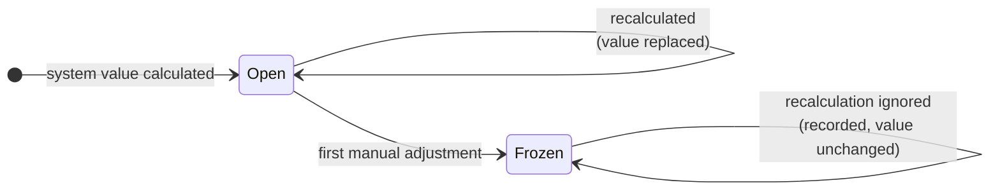

# Payroll: earning line

## Terms

| Term | Meaning |
|---|---|
| Earning line | One line of an employee's pay, for example the base salary of a period. Here a line is known only by its id: the employee, the period and the kind of earning belong to the pay run that contains the line, which is not modelled (Q13). |
| System value | The value the payroll calculation produced from source data. The calculation always sends the whole value of the line, never a change to it. |
| Recalculation | The calculation runs again because source data changed and sends a new system value. |
| Manual adjustment | A signed change (+ or −) added by a payroll specialist, with a mandatory comment. A specialist never sets the value of a line directly; every correction stays visible as its own change. |
| Frozen line | A line that has at least one manual adjustment. Recalculations no longer change it. |
| Current value | Frozen (or latest) system value plus the sum of all manual adjustments. |
| Drift | How far the latest calculated value of a frozen line is from its frozen system value. Kept in the history, never applied to the line. |

## Business rules

1. The payroll calculation creates a line with a system value and may recalculate it when source data changes.
2. A payroll specialist may add manual adjustments to a line over time. An adjustment is a positive or negative amount with a mandatory comment.
3. Adjustments are append-only. A saved adjustment is never edited or removed; a mistake is fixed by a new, compensating adjustment.
4. The first manual adjustment freezes the line at its latest system value. From then on, recalculations do not change the line, even when source data changes; they are kept in the history so nothing the calculation sent is lost. The specialist's adjustments take permanent precedence.
5. The current value of a line and its full history are available at any time.

## Lifecycle

| State | Recalculation | Manual adjustment |
|---|---|---|
| **Open** (no adjustments yet) | replaces the system value and the current value | freezes the line at the latest system value |
| **Frozen** (one or more adjustments) | is recorded for the audit, the value does not change | is appended; the line stays frozen forever |

A line never leaves the frozen state, even if its adjustments add up to zero. Closing a pay period is not modelled yet (see [open questions](#open-questions)).

## Recorded facts

The line keeps its history as a sequence of facts, implemented as domain events. Each fact holds everything needed to rebuild the line, to show its history and to compare a later calculated value with the frozen one.

| Fact | Recorded when | Data |
|---|---|---|
| `SystemValueCalculated` | the calculation creates the line | line id, system value, time |
| `SystemValueRecalculated` | the calculation sends a different value for an open line | line id, new system value, time |
| `SystemRecalculationIgnored` | the calculation sends a different value for a frozen line | line id, the value the calculation sent, time |
| `ManualAdjustmentAdded` | a specialist adjusts the line | line id, adjustment number, amount, comment, specialist id, time |

Times are passed in by the caller, so the domain never reads the system clock and the history is reproducible in tests.

## Reference scenario

The scenario the implementation is checked against, step by step. Amounts are in USD.

| Step | What happens | Amount | Current value |
|---|---|---|---|
| 1 | The calculation creates the line | | 1,000.00 |
| 2 | Source data changes; the line is open, so the new value replaces the old one | | 1,050.00 |
| 3 | Adjustment #1; the line freezes at 1,050.00 | −45.55 | 1,004.45 |
| 4 | Source data changes again; the line is frozen, so the recalculation is only recorded | | 1,004.45 |
| 5 | Adjustment #2 | +100.10 | 1,104.55 |
| 6 | Adjustment #3 | −0.10 | 1,104.45 |
| 7 | Adjustment #4 | −0.20 | 1,104.25 |
| 8 | Adjustment #5 compensates #4, which was a mistake | +0.20 | 1,104.45 |

`ReferenceScenarioTest` checks every step, with several values for step 4, the final history and the full log.

The history shown to the specialist: frozen system value 1,050.00, adjustments −45.55, +100.10, −0.10, −0.20, +0.20, current value 1,104.45. The full log additionally keeps the first value 1,000.00 and the ignored recalculation of step 4.

## Edge cases

Each case lists the behaviour and the test that proves it. Cases are added in the step that implements them.

### Money

| Case | Example | Behaviour | Why | Test |
|---|---|---|---|---|
| Floating-point error | −0.10 + −0.20 | exactly −0.30 | amounts are integer cents parsed from strings | `MoneyTest::testAddsWithoutFloatingPointErrors` |
| Fraction of a cent | `1.005` | rejected | rounding silently would record an amount nobody entered | `MoneyTest::testRejectsInexactAmounts` |
| Out of range | an amount or a sum of 10^13 units of currency or more | rejected before anything is recorded | an integer overflow would flip the sign of the amount | `MoneyTest::testRejectsASumOutsideTheSupportedRange` |
| Another currency | a USD line and a EUR amount | rejected with `CurrencyMismatch` | 100 USD + 5 EUR has no meaningful value without a rate | `MoneyTest::testRefusesToAddAnotherCurrency` |
| Unsupported currency | `JPY` | not representable | it has no minor units, while amounts assume two decimal places (Q6) | the `Currency` enum has no such case |

### Comment

| Case | Example | Behaviour | Why | Test |
|---|---|---|---|---|
| Empty or only spaces | `""`, `"   "` | rejected | a mandatory comment must explain something | `AdjustmentCommentTest::testRejectsABlankComment` |
| Invisible characters only | non-breaking or zero-width spaces, control characters, blank fillers | rejected | otherwise the rule is bypassed with a character that looks like nothing | same |
| Control characters inside | a bell or null character in the text | rejected; tabs and line breaks are kept | they corrupt how the history is displayed | `AdjustmentCommentTest::testRejectsUnreadableText` |
| Surrounding spaces | `"  Bonus  "` | stored as `"Bonus"` | the history keeps what was meant, not the padding | `AdjustmentCommentTest::testTrimsSurroundingWhitespace` |
| Too long | 501 characters | rejected | an append-only history must not accept unbounded text (Q9) | `AdjustmentCommentTest::testRejectsATooLongComment` |

### Freezing and recalculation

| Case | Example | Behaviour | Why | Test |
|---|---|---|---|---|
| Recalculation before the first adjustment | 1,000 → 1,050 | replaces the value; 1,050 is what will be frozen | adjustments must be relative to the value the specialist saw | `EarningLineTest::testTheFirstAdjustmentFreezesTheLatestSystemValue` |
| Recalculation after an adjustment | frozen at 1,050, value 1,004.45, calculation sends 1,100 | value stays 1,004.45; the 1,100 is recorded | the rule says recalculation no longer affects the line; the audit keeps what was sent | `EarningLineTest::testARecalculationOfAFrozenLineIsRecordedButChangesNothing` |
| Adjustments add up to zero | +10, then −10 | the line stays frozen | freezing records a decision of a person, arithmetic does not undo it | `EarningLineTest::testALineStaysFrozenWhenItsAdjustmentsAddUpToZero` |
| Same value sent again | 1,050 sent every night | nothing recorded | an unchanged value carries no information (Q12) | `EarningLineTest::testTheSameValueFromTheCalculationIsNotRecordedAgain` |
| Same ignored value sent again | 1,100 twice for a frozen line | recorded once | compared with the last value sent, not with the frozen one | same |
| Calculation returns to the frozen value | 1,100, then 1,050 | recorded | the drift went back to zero, which the history must show | `EarningLineTest::testAFrozenLineRecordsAReturnToTheFrozenValue` |
| Recalculation in another currency | a EUR value for a USD line | rejected | see Q6 | `EarningLineTest::testRejectsARecalculationInAnotherCurrency` |
| Drift out of the money range | frozen at −10^13, the calculation sends +10^13 | rejected, nothing recorded | drift must always be representable, so a stored value can always be compared; no real pay line comes close | `EarningLineTest::testRejectsACalculatedValueTooFarFromTheFrozenValueWithoutATrace` |

### Adjustments

| Case | Example | Behaviour | Why | Test |
|---|---|---|---|---|
| Zero amount | 0.00 with a comment | rejected, nothing recorded, the line stays open | an adjustment must change something (Q4) | `EarningLineTest::testRejectsAZeroAdjustmentWithoutATrace` |
| Value goes negative | 100.00 and −150.00 | allowed, current value −50.00 | overpayments are recovered this way (Q5) | `EarningLineTest::testAllowsTheValueToBecomeNegative` |
| Result out of range | an adjustment beyond the money range | rejected, nothing recorded | the history must never hold an overflow | `EarningLineTest::testRejectsAnAdjustmentThatWouldLeaveTheSupportedRangeWithoutATrace` |
| Numbering | adjustments between recalculations | numbered 1, 2, 3 among adjustments only; continues after a rebuild | a comment such as "reverts #4" must point to the fourth adjustment | `EarningLineTest::testAdjustmentsAreNumberedInTheOrderTheyWereAdded` |
| Times | added at 11:00 in Kyiv | stored as 09:00 UTC | one time zone in the history (Q10) | `EarningLineTest::testTimesAreRecordedInUtc` |

### History integrity

| Case | Behaviour | Test |
|---|---|---|
| History does not start with the first calculation, or has two | rebuilding fails | `EarningLineReplayTest::testRefusesACorruptedHistory` |
| Recalculation recorded after freezing, or an ignored recalculation of an open line | rebuilding fails | same |
| Gap or repetition in adjustment numbers | rebuilding fails | same |
| Event of another type or another line | rebuilding fails | same, and `AggregateRootTest` |
| Mixed currencies | rebuilding fails | `EarningLineReplayTest::testRefusesAHistoryThatMixesCurrencies` |

Replay checks the rules that protect the money and the order of facts. It does not repeat optimisations of the write path, such as skipping a repeated value. Failing is deliberate: a corrupted history rebuilt "as well as possible" would show a different amount of money with no warning.

## Open questions

Questions for the product owner. Each has the assumption the code makes today and what changes once it is answered. The design keeps every change additive: no answer requires rewriting the existing rules or history.

| # | Question | Assumption today | If the answer differs |
|---|---|---|---|
| Q1 | What does a specialist do when the calculation disagrees with a frozen line (drift)? Does unreviewed drift block closing a period? | drift is recorded, never applied | a new "drift acknowledged" command and event; existing rules unchanged |
| Q2 | Can a frozen line be handed back to automatic calculation? | no, freezing is permanent | a new event that unfreezes; existing events unchanged |
| Q3 | Must a compensating adjustment formally reference the adjustment it corrects? | no, the comment explains it | a new "compensating adjustment added" fact that carries the reference; existing facts unchanged |
| Q4 | Is a zero adjustment (a note without an amount) allowed? | no | remove one check, or add a separate "note" action |
| Q5 | Can the current value of a line become negative? | yes, for example when an overpayment is recovered | one extra invariant in the aggregate |
| Q6 | Which currencies are paid, and can a line or a recalculation come in another currency? | one currency per line, set by the first calculation; amounts have two decimal places; anything in another currency is rejected | another two-decimal currency is one new case of the `Currency` enum; other decimal places need a precision per currency in `Money` |
| Q7 | What happens when a period is closed or paid? Where do corrections after payment go? | not modelled | a `Closed` state and event; later corrections go to the next period |
| Q8 | Who may adjust, and do large amounts need a second approval? | any specialist; the author is recorded | an application-level policy; the domain does not change |
| Q9 | What are the limits of a comment? | 1 to 500 characters after trimming | raising the limit is one constant; a lower limit applies to new input in the application layer, because stored comments must still load |
| Q10 | In which time zone is the history shown? | stored in UTC | formatting at the edge |
| Q11 | Can recalculations arrive out of order (an older calculation after a newer one)? | the last one received wins | the calculation sends a sequence number or run id, and stale values are ignored |
| Q12 | Should a recalculation that sends the same value be recorded? | no, it changes nothing and would flood the history | record it as a "confirmed" fact if the audit needs proof that the calculation ran |
| Q13 | Which employee, period and kind of earning does a line belong to, and must the line itself know it? | the line knows only its id; the pay run that contains it owns that context | a pay run (or payslip) model that references its lines by id; the line's rules stay the same |
| Q14 | How long must a repeated command be recognised? | forever: every processed command id is kept | ids older than the longest retry window of any sender can be removed |
| Q15 | Who chooses the id of a command? | the sender: the calculation for its values, the specialist's screen for an adjustment | nothing changes in the line; a sender that cannot keep ids needs a reference of its own, such as a run id |
| Q16 | What does a specialist see when the line changed while they were looking at it? | the adjustment is refused with the current version of the line; nothing is saved | the screen reloads the line and keeps the specialist's draft |
| Q17 | How does the system know which specialist sends an adjustment? | the sender states it: the HTTP API and the artisan command take the specialist id with the request, there is no sign-in | the id comes from the sign-in at the edge; commands and the line do not change |
